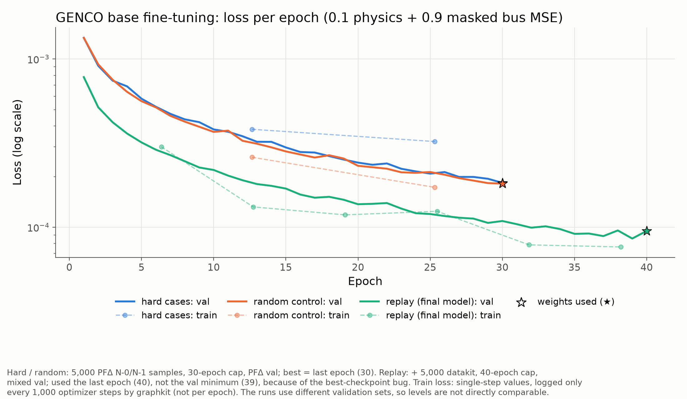
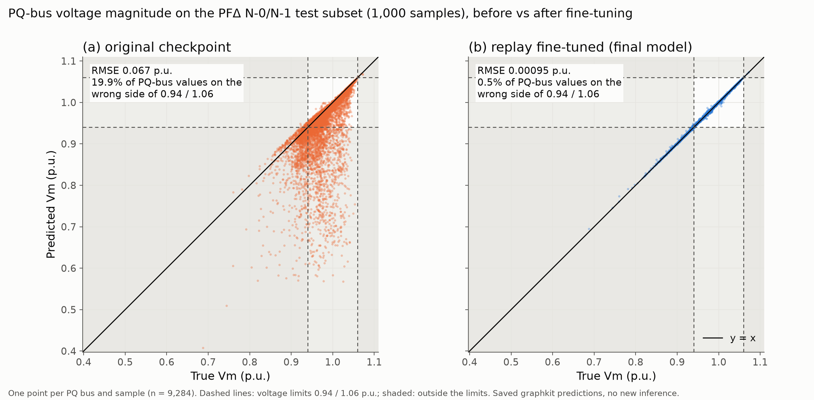

# Extra analyses for the report (additive; the frozen pipeline is unchanged)

All code is in `scripts/extra/`, all outputs are in `results/extra/`. Nothing in `scripts/`, `configs/`, `data/`,
`checkpoints/`, `mlruns/` or the existing `results/` files was changed. No retraining, no probe refit, no threshold
change. N-2 was used only for the final evaluation of the new baseline. Seeds are fixed (sklearn `random_state=0`,
torch/numpy seed 0). Facts for the report, with sources: `report_facts.md`.

## 1. Baseline ML model without GridFM (`baseline_raw_inputs.py`)

- **Inputs (64 raw features):**
  - per-bus Pd and Qd (28)
  - non-slack generator Pg setpoints (4); the slack Pg is a power-flow result and is excluded
  - generator Vm setpoints (5; 0 if the generator is out)
  - total Pd and total Qd
  - outage indicators for 20 branches and 5 generators
  - no GENCO embeddings or predictions
- **Samples:** the frozen probes' split from `results/stage3_mapping.csv`.
  - Train: `pf_probe` + `dk_probe` (4,000).
  - Val: `pf_val` + `dk_val` (2,000).
- **Selection rule:** the same as the probes. Hyperparameters by val PR-AUC; decision threshold = max val F1, using
  `stage3_detectors.best_threshold`, imported unchanged.
- **Models:**
  - logistic regression: `StandardScaler`, balanced class weights, C grid as in the probes
  - `HistGradientBoostingClassifier`: lr {0.05, 0.1} × leaves {15, 31}, 300 iterations, `random_state=0`
- **Files:**
  - `baseline_raw_inputs.csv`: P, R, F1, false alarms, misses and PR-AUC per test set and label
  - `baseline_raw_inputs_chosen.csv`, `baseline_raw_inputs_tuning.csv`
  - `baseline_raw_inputs_comparison.csv`: the full table, with precision, recall and PR-AUC

### Combined detector table: F1 (false alarms / misses), 1,000 test samples each

The existing rows are copied from `results/final_n2_detectors.csv` (scope "all"); they were not recomputed.
V = y_voltage, O = y_overload.
Residual routing for the replay model is identical to its limit check: the frozen gate is t = ∞, so nothing is routed.
Residual routing for the original model sends 0 % of datakit, 65.6 % of PFΔ N-0/N-1 and 45 % of N-2 samples to the solver.

| Method | datakit V | datakit O | PFΔ N-0/N-1 V | PFΔ N-0/N-1 O | **N-2 V** | **N-2 O** |
|---|---|---|---|---|---|---|
| limit check (PtC) [original] | 0.982 (0/1) | 1.000 (0/0) | 0.858 (161/7) | 0.782 (173/4) | 0.929 (68/23) | 0.759 (58/6) |
| **limit check (PtC) [replay]** | 0.982 (0/1) | 1.000 (0/0) | **0.994 (0/6)** | **0.995 (0/3)** | **0.985 (1/17)** | 0.931 (1/13) |
| residual routing [original] | 0.982 (0/1) | 1.000 (0/0) | 0.986 (8/7) | 0.991 (6/0) | 0.976 (9/20) | **0.955 (8/2)** |
| probe logreg [original] | 0.793 (7/5) | 1.000 (0/0) | 0.900 (47/55) | 0.900 (27/36) | 0.884 (32/103) | 0.721 (10/41) |
| probe MLP [original] | 0.696 (2/12) | 1.000 (0/0) | 0.897 (49/56) | 0.866 (46/41) | 0.870 (35/115) | 0.655 (12/49) |
| probe logreg [replay] | 0.857 (4/4) | 1.000 (0/0) | 0.929 (28/44) | 0.938 (14/25) | 0.914 (41/63) | 0.783 (25/22) |
| probe MLP [replay] | 0.842 (5/4) | 1.000 (0/0) | 0.921 (49/34) | 0.936 (18/23) | 0.922 (52/45) | 0.784 (17/27) |
| *new:* raw-input logreg | – (0 of 28 found; 1/28) | 1.000 (0/0) | 0.867 (67/70) | 0.873 (38/43) | 0.638 (22/318) | 0.626 (18/50) |
| *new:* raw-input HGB | 0.741 (6/8) | 1.000 (0/0) | 0.896 (57/51) | 0.906 (12/45) | 0.743 (28/236) | 0.417 (3/78) |

Positives per set (V / O): datakit 28 / 37, PFΔ N-0/N-1 515 / 321, N-2 618 / 107.

## 2. Classical solver comparison (`solver_pandapower.py`, `genco_timing.py`, `solver_timing_table.py`)

- **Separate venv:** `D:/school/DeepLearning/venv_extra`, outside the repo so `git status` stays clean. It has
  pandapower 3.1.2, numba and pandas 2.2.3; the pandas pin is needed because pandapower 3.1.2 fails with pandas 3.x.
  The package list is in `scripts/extra/requirements_extra.txt`.
- **Network per sample:** built from the sample's raw data (loads, shunts, generator Pg/Vm setpoints, in-service
  flags, branch r/x/b/tap/shift/status), via `from_ppc`.
- **Solve:** `pp.runpp(algorithm="nr", init="flat", enforce_q_lims=False)`. Q limits are not enforced because the
  PFΔ ground truth violates them.
- **Sanity check, 20 samples per set** (`solver_nr_sanity20.csv`):
  - **The first attempt failed**, on 2 of 60 samples (datakit #11: Vm off by 4.8e-3 p.u., Va by 5.9°).
  - Cause: `from_ppc` ignores the branch status of **transformers**, so an outaged transformer stayed in service.
  - Fix: set `in_service` explicitly from `br_status`.
  - After the fix: max |ΔVm| ≤ 4.8e-7 p.u. and max |ΔVa| ≤ 3.9e-5° on all 60 samples, and the check passed.
  - Only then was timing run.
- **Full run, 3,000 samples:**
  - **0 NR convergence failures.**
  - Max |ΔVm| = 8e-10 (datakit), 3e-7 (PFΔ), 7e-7 p.u. (N-2).
  - Labels recomputed from the NR solution agree with the dataset labels on **100 %** of samples, for both labels.
- **CPU:** Intel, 28 logical cores. NR and GENCO were timed one after the other, never in parallel. The NR timing
  was repeated on an idle CPU; that run is the one reported. Run 1 (`*_run1.*`) was 3–4 % slower because a
  file-listing job was running at the same time.

### Timing (`solver_timing.csv`), ms per sample

| Test set | NR, numba (1 thread) | NR, no numba | GENCO bs 1 (20 thr) | GENCO bs 1 (1 thr) | **GENCO bs 64 (20 thr)** | GENCO bs 64 (1 thr) |
|---|---|---|---|---|---|---|
| datakit | 8.5 (mean 10.4) | 12.6 | 32.4 | 26.5 | **1.88** (533 samples/s) | 5.3 |
| PFΔ N-0/N-1 | 8.2 (mean 9.4) | 12.1 | 34.4 | 29.5 | **1.91** (525 samples/s) | 5.7 |
| PFΔ N-2 | 8.4 (mean 9.6) | 12.4 | 33.9 | 30.1 | **1.80** (556 samples/s) | 6.8 |

**What was timed:**
- **NR:** median per-sample `runpp` wall time. It includes pandapower's own Python overhead; building the net is not timed.
- **GENCO:** replay checkpoint, `predict_step`, which covers the forward pass plus de-normalisation and the physics
  decoder (branch flows, injections, residuals). Batch size 64 is the batch size used in every inference run of the
  project. 5 warm-up batches are excluded, and data loading / graph building is not timed.
- **Check:** the timed GENCO model reproduces the saved frozen replay predictions (max |ΔVm| ≤ 1e-5, float noise).

**Interpretation:** the labels come from a solver, so **the solver is the accuracy reference**. It is exact by
definition (agreement 100 %, 0 failures here), and this comparison is only about speed. On a 14-bus grid NR is
already fast. GENCO is faster only when batched: 4.3–4.7× faster than NR with 20 threads, and 1.2–1.6× with a
single thread, the fair comparison to single-threaded NR. Per sample at batch size 1, **GENCO is 3–4× slower than
NR**. A speed advantage would be expected on much larger grids, but case14 cannot show it.

## 3. Loss curves (`loss_curves.py`) → `figures/fig_finetune_loss_curves.png`

- **Validation loss:** one value per epoch from MLflow, plotted on a log y-axis.
- **Training loss:** graphkit logs it only every 1,000 optimizer steps (`log_every_n_steps=1000`), giving 2 / 2 / 6
  single-step points. These are shown as light dashed markers; **there is no per-epoch train loss**.
- **Weights used:** ★ marks them. Hard and random used epoch 30 (val minimum = last epoch, checked). Replay used
  epoch 40, the last epoch, although the val minimum was at epoch 39 (8.57e-5 vs 9.51e-5).
- **No pretraining panel:** the checkpoint's `metrics.csv` holds only 4 final test metrics, with no per-epoch loss.
- **Data:** `finetune_loss_curves.csv`.

## 4. Qualitative before/after (`qualitative.py`) → `figures/fig_finetune_qualitative.png`

- **Data:** saved predictions, no new inference. PQ-bus Vm on PFΔ N-0/N-1: 9,284 bus values from 1,000 samples.
- **RMSE:** 0.067 p.u. (original) → 0.00095 p.u. (replay). This matches `finetune_summary.md`.
- **Values on the wrong side of a limit:** 19.9 % → 0.45 %.
- **Error direction:** the original model mostly predicts Vm *too low*: points fall below y = x, often
  crossing 0.94, which gives false under-voltage alarms.
- **Data:** `qualitative_vm_stats.csv`.

## Surprises / things to flag

1. **On in-distribution data, a raw-input model nearly matches the embedding probes.**
   - On PFΔ N-0/N-1, raw-input HGB reaches F1 0.896 / 0.906, vs 0.92–0.94 for the replay probes.
   - It even beats the original-model probes on overload (0.906 vs 0.866–0.900).
   - **It collapses on N-2:** voltage recall 0.62 (HGB) / 0.49 (logreg), overload recall 0.27 (HGB).
   - So the GENCO embeddings add little within the training distribution but transfer much better to unseen
     topologies. This is the strongest argument for the probes.
2. **Raw-input logreg finds 0 of 28 datakit voltage violations.** datakit's over-voltages are not linearly separable
   from the raw inputs at the val-chosen threshold; HGB finds 20 of 28.
3. **GENCO is not faster than NR per single case14 sample** (26–34 ms vs 8.4 ms). It wins only when batched. With
   batch size 1, 20 threads is *slower* than 1 thread because of threading overhead.
4. **pandapower `from_ppc` silently ignores the outage status of transformers.** The first sanity check caught it.
   With the fix, datakit is reproduced to 1e-9 p.u., which suggests it was generated with pandapower itself.
5. **An existing summary sentence overstates the probe split.** `stage3_summary.md` says `pf_probe` is "not in any
   fine-tuning set", but 657 of its 2,000 samples are in the *hard* fine-tuning set. The frozen results are not
   affected: the probes use the original and replay models, and replay's training overlap with `pf_probe` is 0.
   Details in `report_facts.md` §1.
6. **NR never fails here (0 / 3,000), including on N-2.** This is expected rather than impressive: PFΔ keeps only
   feasible, solved samples, so the test sets contain no hard-to-converge cases.
7. **All six N-2 numbers to verify match `final_n2_summary.md` exactly** (`report_facts.md` §6).
